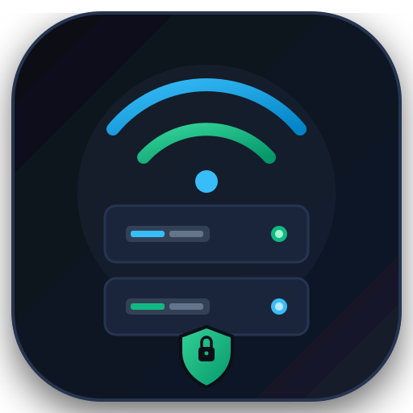
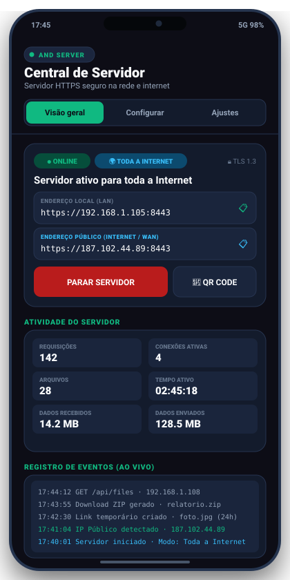
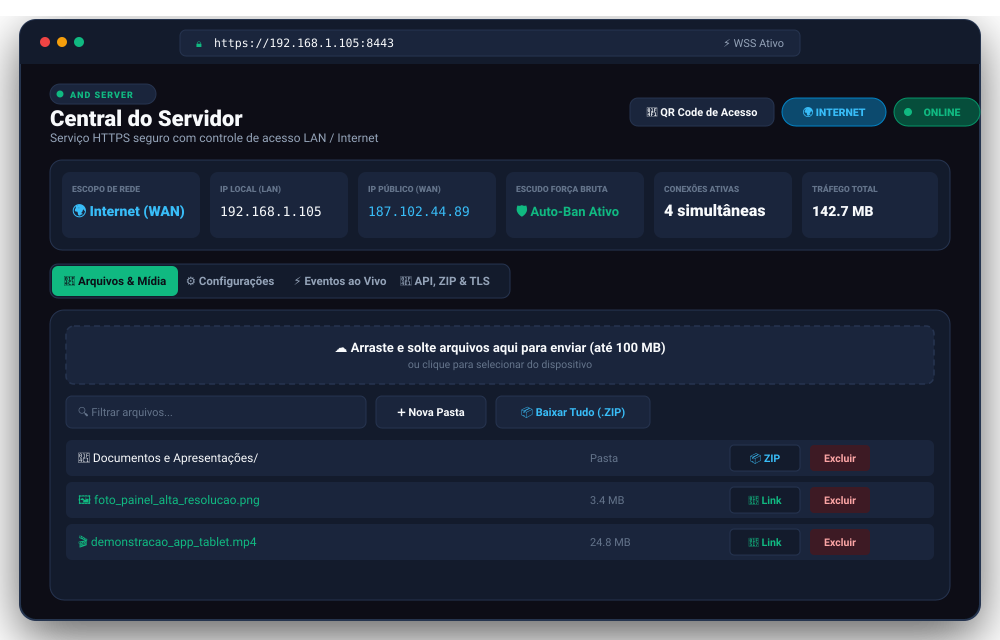
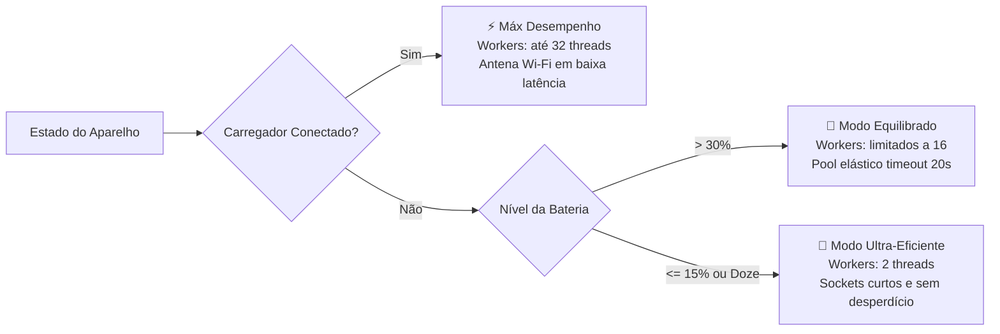
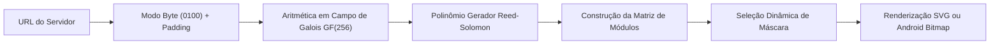

# AndServer 🚀

<p align="center">
  
</p>

<p align="center">
  
  
  
  
  
  
</p>

O **AndServer** é um aplicativo Android nativo de nível profissional, desenvolvido em **Kotlin puro sem dependências externas**, projetado para transformar qualquer smartphone ou tablet em uma central de infraestrutura completa: **servidor HTTPS moderno, unidade de rede WebDAV na nuvem pessoal, servidor de streaming para Smart TVs e hospedagem de sites estáticos/SPAs**. O aplicativo opera com eficiência tanto na **Rede Local (LAN)** quanto na **Internet Global (WAN)** com detecção de IP público e suporte a encaminhamento de portas.

---

## 📑 Índice Detalhado

1. [Visão Geral e Filosofia Arquitetural](#-visão-geral-e-filosofia-arquitetural)
2. [Demonstração Visual da Interface](#-demonstração-visual-da-interface)
3. [Arquitetura do Sistema e Estrutura de Código](#-arquitetura-do-sistema-e-estrutura-de-código)
4. [Perfis de Servidor Operacionais](#-perfis-de-servidor-operacionais)
5. [Topologia de Rede: Local (LAN) vs. Internet (WAN)](#-topologia-de-rede-local-lan-vs-internet-wan)
6. [Gerenciamento de Armazenamento e Particionamento](#-gerenciamento-de-armazenamento-e-particionamento)
7. [Motor de Eficiência Energética e Hardware (DevicePowerManager)](#-motor-de-eficiência-energética-e-hardware-devicepowermanager)
8. [Unidade de Rede Local WebDAV (RFC 4918)](#-unidade-de-rede-local-webdav-rfc-4918)
9. [Central de Streaming Multimídia & Smart TVs](#-central-de-streaming-multimídia--smart-tvs)
10. [Hospedagem de Sites Web e SPAs (`/hosted/www`)](#-hospedagem-de-sites-web-e-spas-hostedwww)
11. [Gerador Nativo de QR Code (GF256 & Reed-Solomon)](#-gerador-nativo-de-qr-code-gf256--reed-solomon)
12. [Camada de Segurança, Criptografia e Firewall](#-camada-de-segurança-criptografia-e-firewall)
13. [Catálogo Completo da API REST & WebSocket](#-catálogo-completo-da-api-rest--websocket)
14. [Interface Adaptativa com SafeArea (Edge-to-Edge)](#-interface-adaptativa-com-safearea-edge-to-edge)
15. [Sistema de Auto-Atualização Integrado (PackageInstaller)](#-sistema-de-auto-atualização-integrado-packageinstaller)
16. [Pipeline de CI/CD e Publicação Automatizada](#-pipeline-de-cicd-e-publicação-automatizada)
17. [Instalação, Compilação e Configuração Inicial](#-instalação-compilação-e-configuração-inicial)
18. [Guia de Solução de Problemas (Troubleshooting)](#-guia-de-solução-de-problemas-troubleshooting)

---

## 💡 Visão Geral e Filosofia Arquitetural

A maioria dos servidores para Android depende de pesadas bibliotecas de terceiros (como Ktor, OkHttp, Netty, NanoHTTPD ou runtimes Node.js embutidos), resultando em APKs volumosos, alto consumo de memória RAM e esgotamento rápido da bateria. O **AndServer** foi construído sob uma premissa radical de engenharia de software:

- **Zero Dependências Externas (0 KB de bibliotecas de terceiros)**: O servidor HTTP/1.1, motor TLS, protocolo WebSocket RFC 6455, motor WebDAV RFC 4918, codec matemático de QR Code Reed-Solomon, streaming de ZIP e interface adaptativa utilizam estritamente o Android SDK nativo e a biblioteca padrão do Kotlin (`kotlin-stdlib`).
- **Tamanho Minúsculo de Binário**: O APK compilado final ocupa cerca de **2 MB a 3 MB**, instalando instantaneamente em qualquer aparelho.
- **Ampla Compatibilidade**: Suporta desde o **Android 8.0 (API 26)** até as versões mais recentes do **Android 15+ (API 35)**.
- **Hardware & Battery Aware**: O servidor adapta dinamicamente o número de threads operárias, buffers de socket e tempos limite dependendo se o aparelho está no carregador, com bateria cheia ou em modo de economia de energia.
- **Transparência de Rede e Descoberta Local**: Publica automaticamente serviços via mDNS / DNS-SD (`_https._tcp.`) na rede Wi-Fi, permitindo que clientes Bonjour, Mac, iOS e Linux descubram o servidor sem digitação prévia de IPs.

---

## 📸 Demonstração Visual da Interface

O projeto inclui mockups e telas reais em alta fidelidade vetorial SVG e renderizações gráficas:

### 📱 1. Aplicativo no Celular vs. 📟 Layout Adaptativo no Tablet

<p align="center">
  
  &nbsp;&nbsp;&nbsp;&nbsp;
  
</p>

* **Mobile (à esquerda)**: Otimizado para navegação com uma só mão, respeito rigoroso a entalhes de tela (SafeArea/Cutout), cartões dinâmicos de status, endereços de rede clicáveis (copia com um toque) e métricas consolidadas.
* **Tablet (à direita)**: Detecta telas com largura mínima de 600dp e divide a visualização em duas colunas ergonômicas: controles rápidos e endereços na esquerda; métricas de telemetria e terminal de log contínuo na direita.

---

### 🌐 2. Painel Web Responsivo (Navegador Desktop e Mobile)

<p align="center">
  
</p>

* Painel acessível via qualquer navegador moderno (`https://<ip>:<porta>`).
* Suporte completo a **arrastar e soltar (Drag & Drop)** de múltiplos arquivos.
* Filtros de pesquisa em tempo real, medidor visual de armazenamento do aparelho, download em lote (.ZIP), gerador de links expiráveis e reprodutor multimídia embutido.

---

### 📲 3. Conexão Instantânea via QR Code

<p align="center">
  
</p>

* Conecte notebooks, smartphones e smart TVs apontando a câmera para o QR Code gerado matematicamente pelo próprio aparelho — dispensando digitação manual de portas ou endereços IP.

---

## 🏛️ Arquitetura do Sistema e Estrutura de Código

O fluxo operacional e de comunicação entre as camadas do sistema pode ser visualizado abaixo:

```mermaid
flowchart TD
    subgraph Android["Dispositivo Android"]
        UI["MainActivity (Interface Adaptativa em Código Puro)"]
        Service["ServerService (Foreground Service + mDNS NSD)"]
        PowerMgr["DevicePowerManager (Térmico, Bateria & Wi-Fi Lock)"]
        Keystore["Android KeyStore (RSA 2048 / TLS 1.3 / X.509)"]
        LanServer["LanHttpServer (Engine HTTPS Multi-Threaded)"]
        WebDav["WebDavHandler (RFC 4918 Engine)"]
        MediaStream["MediaStreamHandler (Catálogo & Playlist M3U)"]
        WSHandler["WebSocketHandler (RFC 6455 Frame Parser)"]
        SiteMgr["SiteTemplateManager (/hosted/www SPA Engine)"]
        QRGen["QrGenerator (GF256 / Reed-Solomon Nativo)"]
        Storage["Sistema de Arquivos (Interno vs SD Card)"]
    end

    subgraph Clientes["Clientes & Dispositivos Externos"]
        Browser["Navegadores Web (Desktop / Mobile)"]
        WinExplorer["Windows Explorer / Mac Finder (WebDAV Drive)"]
        SmartTV["Smart TVs / VLC / Kodi (Streaming M3U & Range 206)"]
        WSClient["Painel Web Telemetria (WSS /ws)"]
    end

    UI <-->|LocalBinder| Service
    Service -->|Ciclo de Vida| LanServer
    Service -->|Monitora Estado| PowerMgr
    PowerMgr -->|Ajusta Workers & Locks| LanServer
    Keystore -->|Certificado PEM & SSLContext| LanServer

    LanServer --> WebDav
    LanServer --> MediaStream
    LanServer --> WSHandler
    LanServer --> SiteMgr
    LanServer --> QRGen
    LanServer --> Storage

    Browser <-->|HTTPS porta 8443| LanServer
    WinExplorer <-->|WebDAV PROPFIND / PUT| WebDav
    SmartTV <-->|HTTP Range 206 / M3U| MediaStream
    WSClient <-->|WSS /ws (Logs em Tempo Real)| WSHandler
```

### Componentes de Código Modularizados (`com.andserver`):

| Arquivo | Linhas | Camada | Responsabilidade Técnica |
| :--- | :---: | :--- | :--- |
| **[MainActivity.kt](file:///c:/Users/aldo/Documents/AndServer/app/src/main/java/com/andserver/MainActivity.kt)** | ~390 | UI / Shell | Atividade raiz, controle de `WindowInsets` (SafeArea/Notch), barra inferior/lateral responsiva, comunicação com `ServerService` via `ServiceConnection` e receptor de instalações de APK. |
| **[DashboardView.kt](file:///c:/Users/aldo/Documents/AndServer/app/src/main/java/com/andserver/DashboardView.kt)** | ~470 | UI | Exibição de status online/offline, cópia de IP com 1 toque, métricas de tráfego (bytes enviados/recebidos, uptime, requisições) e modal de QR Code. |
| **[SetupView.kt](file:///c:/Users/aldo/Documents/AndServer/app/src/main/java/com/andserver/SetupView.kt)** | ~290 | UI | Configuração de perfil operacional, seleção de escopo de rede (LAN vs Internet) e filtros de extensões de arquivos. |
| **[SettingsView.kt](file:///c:/Users/aldo/Documents/AndServer/app/src/main/java/com/andserver/SettingsView.kt)** | ~430 | UI | Seleção de armazenamento (Interno vs SD Card), ajuste de porta (1024–65535), número de workers, senha administrativa, utilitários do WebDAV/Streaming e limpeza de cache. |
| **[UpdatesView.kt](file:///c:/Users/aldo/Documents/AndServer/app/src/main/java/com/andserver/UpdatesView.kt)** | ~210 | UI | Interface de verificação de novas versões do app direto do GitHub Releases com download e instalação assistida. |
| **[UiTheme.kt](file:///c:/Users/aldo/Documents/AndServer/app/src/main/java/com/andserver/UiTheme.kt)** | ~110 | UI Design | Tokens de design visual em código (Cores Dark Slate, Emerald, Sky Blue), bordas arredondadas e fábrica de drawables sem arquivos XML. |
| **[ServerService.kt](file:///c:/Users/aldo/Documents/AndServer/app/src/main/java/com/andserver/ServerService.kt)** | ~223 | Background | `Foreground Service` com notificação persistente interativa, registro mDNS/NSD (`_https._tcp.`) e isolamento de ciclo de vida. |
| **[LanHttpServer.kt](file:///c:/Users/aldo/Documents/AndServer/app/src/main/java/com/andserver/LanHttpServer.kt)** | ~861 | Core Engine | Motor central HTTPS multi-threaded, parser de requisições, compressão dinâmica GZIP, buffer de 128 KB, escudo anti-força bruta e roteamento unificado. |
| **[DevicePowerManager.kt](file:///c:/Users/aldo/Documents/AndServer/app/src/main/java/com/andserver/DevicePowerManager.kt)** | ~130 | Hardware | Gestão de bateria, estado do carregador, Doze Mode, contagem de CPUs e controle dinâmico de `WifiLock` (adquirido apenas durante transferências ativas). |
| **[WebDavHandler.kt](file:///c:/Users/aldo/Documents/AndServer/app/src/main/java/com/andserver/WebDavHandler.kt)** | ~162 | Protocolos | Implementação nativa da RFC 4918: `PROPFIND` com XML Multi-Status 207, `LOCK`, `UNLOCK`, `PROPPATCH`, `MOVE`, `COPY`. |
| **[MediaStreamHandler.kt](file:///c:/Users/aldo/Documents/AndServer/app/src/main/java/com/andserver/MediaStreamHandler.kt)** | ~80 | Mídia | Varredura assíncrona de arquivos multimídia, geração de playlist `#EXTM3U` e catálogo JSON para Smart TVs e players de vídeo. |
| **[WebSocketHandler.kt](file:///c:/Users/aldo/Documents/AndServer/app/src/main/java/com/andserver/WebSocketHandler.kt)** | ~120 | Tempo Real | Protocolo WebSocket RFC 6455 nativo: decodificação de máscaras de payload, frames de texto/binário, ping/pong e broadcast de telemetria. |
| **[WebDashboardRenderer.kt](file:///c:/Users/aldo/Documents/AndServer/app/src/main/java/com/andserver/WebDashboardRenderer.kt)** | ~980 | Web Engine | Geração em tempo real do frontend Single Page Application (HTML5/CSS3/ES6) com Drag & Drop, player inline de mídia e visualizador de diretórios. |
| **[SiteTemplateManager.kt](file:///c:/Users/aldo/Documents/AndServer/app/src/main/java/com/andserver/SiteTemplateManager.kt)** | ~530 | Web Hosting | Inicializador e gerenciador do site padrão em `/hosted/www`, com layout moderno responsivo e testador interativo de chamadas de API. |
| **[TlsIdentity.kt](file:///c:/Users/aldo/Documents/AndServer/app/src/main/java/com/andserver/TlsIdentity.kt)** | ~53 | Segurança | Geração de par de chaves assimétricas RSA 2048 e certificado X.509 de 10 anos diretamente no hardware seguro do **Android KeyStore**. |
| **[QrGenerator.kt](file:///c:/Users/aldo/Documents/AndServer/app/src/main/java/com/andserver/QrGenerator.kt)** | ~256 | Algoritmo | Implementação matemática completa de QR Code (Versões 3, 4 e 5) com polinômios geradores Reed-Solomon em campos de Galois $GF(2^8)$. |
| **[GithubReleaseUpdater.kt](file:///c:/Users/aldo/Documents/AndServer/app/src/main/java/com/andserver/GithubReleaseUpdater.kt)** | ~140 | Atualização | Cliente HTTP nativo para consumo da GitHub Releases API e despacho para o `PackageInstaller` nativo. |
| **[ServerModels.kt](file:///c:/Users/aldo/Documents/AndServer/app/src/main/java/com/andserver/ServerModels.kt)** | ~115 | Dados | Modelos imutáveis: `ServerSnapshot`, `ServerConfig`, `ServerProfile`, `IpBlock`, `ShareLink` e estruturas de frames de rede. |
| **[FormatUtils.kt](file:///c:/Users/aldo/Documents/AndServer/app/src/main/java/com/andserver/FormatUtils.kt)** | ~110 | Utilitários | Formatação rápida de bytes, tempos de uptime, datas padrão RFC 1123 HTTP, detecção de IP LAN e escape seguro de JSON/HTML. |
| **[MimeTypes.kt](file:///c:/Users/aldo/Documents/AndServer/app/src/main/java/com/andserver/MimeTypes.kt)** | ~105 | Utilitários | Dicionário de dezenas de tipos MIME com categorização (imagens, áudio, vídeo, documentos, arquivos compactados) e filtragem. |

---

## 🧭 Perfis de Servidor Operacionais

O AndServer disponibiliza **6 modos de operação pré-configurados** que ajustam rotas, cabeçalhos e permissões:

| Perfil | Identificador | Ícone | Rota Padrão na Raiz (`/`) | Casos de Uso Recomendados |
| :--- | :--- | :---: | :--- | :--- |
| **Drive na Rede Local** | `drive` | 💾 | Explorador de Arquivos WebDAV | Mapeamento do celular como disco local no Windows Explorer, Mac Finder ou Linux. |
| **Servidor de Streaming & Mídia** | `streaming`| 🎬 | Player de Vídeo e Áudio | Transmissão de filmes, séries e músicas para Smart TVs, VLC Media Player e Kodi. |
| **Site Web Hospedado** | `site` | 🚀 | `index.html` do `/hosted/www` | Hospedagem de sites estáticos, landing pages, documentações e SPAs com rotas virtuais. |
| **Central Web & Arquivos** | `web` | 🌐 | Painel Administrativo Completo | Gerenciador de arquivos completo no navegador com Drag & Drop e telemetria ao vivo. |
| **Servidor de Arquivos Simples**| `files` | 📁 | Índice Direto de Diretórios | Compartilhamento rápido e direto de pastas sem scripts pesados no navegador. |
| **Servidor de API Rest** | `api` | ⚡ | Resposta JSON da API (`/api/status`)| Integrações M2M (Machine-to-Machine), IoT, automações via Python, cURL ou Node.js. |

---

## 🌐 Topologia de Rede: Local (LAN) vs. Internet (WAN)

O aplicativo permite alternar dinamicamente entre dois escopos de segurança de rede:

### 🏠 Modo 1: Apenas Rede Local (LAN Privada)
- **Filtro de IPs RFC 1918**: O motor valida cada conexão recebida antes de processar qualquer cabeçalho. São aceitos apenas IPs dos intervalos privados:
  - `10.0.0.0/8`
  - `172.16.0.0/12` (172.16.0.0 a 172.31.255.255)
  - `192.168.0.0/16`
  - Loopback (`127.0.0.1`, `::1`) e Link-Local.
- **Firewall Imediato**: Conexões oriundas de IPs públicos externos são rejeitadas com `HTTP 403 Forbidden`:
  ```json
  {
    "error": "Acesso restrito a rede local. Altere para o modo 'Toda a Internet' para conexoes externas."
  }
  ```

### 🌍 Modo 2: Toda a Internet (WAN Público)
- **Acesso Irrestrito**: Conexões de qualquer IP global são autorizadas a negociar TLS e autenticar.
- **Detecção Automática de IP Público**: O servidor efetua uma requisição assíncrona ultraleve via `https://api.ipify.org` e passa a exibir seu endereço IP de Internet real tanto no painel do Android quanto no painel web.
- **Configuração de Roteador Residencial (Port Forwarding)**:
  1. Descubra o IP local do celular exibido no app (Exemplo: `192.168.1.150`).
  2. Acesse as configurações do seu roteador Wi-Fi (geralmente `192.168.1.1`).
  3. Navegue até a seção **Redirecionamento de Portas (Port Forwarding / Virtual Server)**.
  4. Crie uma regra redirecionando a porta externa `8443` (TCP) para o IP do smartphone `192.168.1.150` na porta `8443`.
  5. Acesse de qualquer lugar do mundo via: `https://SEU_IP_PUBLICO:8443`.

---

## 💾 Gerenciamento de Armazenamento e Particionamento

O AndServer oferece suporte completo à seleção da pasta base de armazenamento onde os arquivos residem:

1. **Armazenamento Interno Privado (`internal`)**:
   - Caminho: `/data/user/0/com.andserver/files/hosted/`
   - Vantagens: Maior velocidade de leitura e gravação (memória flash UFS/eMMC nativa) e proteção contra remoção acidental.
2. **Cartão SD / Armazenamento Externo (`external`)**:
   - Caminho: `/storage/.../Android/data/com.andserver/files/hosted/`
   - Vantagens: Permite hospedar dezenas ou centenas de gigabytes de filmes, músicas e backups sem ocupar a memória interna do smartphone.

### Proteções de Escrita e Performance:
- **Gravação Atômica com Staging Seguro**: Durante o upload de arquivos (`PUT`), os dados são gravados inicialmente em um arquivo temporário oculto (`.nome.uuid.upload`). Somente após a sincronização completa em disco (`out.fd.sync()`), o arquivo é movido atomicamente para o destino final com `StandardCopyOption.ATOMIC_MOVE`. Isso impede que quedas de conexão corrompam arquivos existentes.
- **Contagem Reativa de Arquivos**: O servidor evita varreduras de disco contínuas que acordariam a CPU do celular. A recontagem de arquivos é efetuada sob demanda em segundo plano com um intervalo mínimo de 60 segundos entre execuções.

---

## ⚡ Motor de Eficiência Energética e Hardware (DevicePowerManager)

Para garantir que o smartphone possa funcionar ininterruptamente como servidor 24 horas por dia sem sobreaquecer ou consumir bateria em excesso, o componente `DevicePowerManager` orquestra:



- **Wi-Fi Lock Sob Demanda**: Diferente de aplicativos convencionais que mantêm a antena Wi-Fi travada em modo de alta potência ininterruptamente, o AndServer adquire o `WIFI_MODE_FULL_HIGH_PERF` **apenas enquanto houver transferências ativas de arquivos**. Assim que o tráfego cessa, a trava é liberada, permitindo que o rádio Wi-Fi entre em repouso e o Android economize bateria.
- **Pool Elástico com Descarte de Threads**: O `ThreadPoolExecutor` utiliza `allowCoreThreadTimeOut(true)` com tempo de expiração de 20 segundos. Se o servidor estiver sem clientes, todas as threads operárias são destruídas, mantendo o consumo de memória perto de zero.

---

## 📂 Unidade de Rede Local WebDAV (RFC 4918)

O AndServer implementa nativamente a especificação **RFC 4918**, permitindo que o celular se transforme em um **Network Drive** mapeado no sistema operacional do seu computador sem necessidade de instalar nenhum software adicional.

### Métodos WebDAV Implementados:
- `PROPFIND`: Retorna a árvore de pastas e metadados no formato padronizado XML `207 Multi-Status`.
- `MKCOL`: Cria novos diretórios no dispositivo.
- `PUT`: Envio de arquivos de até 500 MB com gravação contínua em buffer de 64 KB.
- `DELETE`: Exclusão recursiva de arquivos e diretórios.
- `MOVE`: Renomeação ou movimentação de arquivos através do cabeçalho HTTP `Destination`.
- `COPY`: Cópia de arquivos e diretórios com preservação da estrutura.
- `LOCK` & `UNLOCK`: Fornece tokens de bloqueio (`opaquelocktoken`) para compatibilidade perfeita com o Windows Explorer e aplicações Office.

---

### 🖥️ Como Mapear no Computador:

#### 1. No Windows 11 / 10 (Windows Explorer)
1. Abra o Windows Explorer (`Win + E`).
2. Clique em **Este Computador** e, na barra superior, selecione **Mapear unidade de rede** (ou clique com o botão direito em "Este Computador" > *Mapear unidade de rede*).
3. Escolha uma letra de unidade (Exemplo: `Z:`).
4. No campo **Pasta**, digite o endereço HTTPS do servidor:
   ```text
   https://192.168.1.150:8443/webdav
   ```
5. Marque a opção **Reconectar-se na entrada** e clique em **Concluir**.
6. Se configurou senha no app, insira as credenciais quando solicitadas.
7. *Pronto! Seu celular agora aparece como um disco local no seu computador.*

#### 2. No macOS (Finder)
1. No Finder, pressione as teclas `Command (⌘) + K` (ou vá no menu *Ir* > *Conectar ao Servidor...*).
2. No campo **Endereço do Servidor**, digite:
   ```text
   https://192.168.1.150:8443/webdav
   ```
3. Clique em **Conectar**, confirme o certificado e monte a unidade.

#### 3. No Linux (Ubuntu, Debian, Fedora, Arch)
1. Abra o gerenciador de arquivos (Nautilus, Dolphin ou Thunar).
2. Selecione **Outros Locais** > **Conectar ao Servidor**.
3. Digite o endereço utilizando o esquema DAVS:
   ```text
   davs://192.168.1.150:8443/webdav
   ```

#### 4. Em Smartphones e Tablets (Android / iOS)
- Utilize clientes como **CX File Explorer**, **Solid Explorer** ou **Documents by Readdle**, adicionando uma nova conexão do tipo **WebDAV (HTTPS)** na porta `8443`.

---

## 🎬 Central de Streaming Multimídia & Smart TVs

O AndServer transforma o aparelho em uma central de entretenimento para transmitir mídias diretamente para Smart TVs e reprodutores de rede:

### 1. Playlist M3U Estendida Dinâmica (`/stream/playlist.m3u`)
O servidor vasculha em tempo real os arquivos de vídeo (`.mp4`, `.mkv`, `.webm`, `.mov`, `.avi`, `.ts`) e áudio (`.mp3`, `.flac`, `.wav`, `.ogg`, `.m4a`, `.aac`) e compila uma lista no formato `#EXTM3U` com URLs absolutas:

```m3u
#EXTM3U
#EXTINF:-1 tvg-id="video-1" group-title="Vídeos",Apresentacao_Projeto.mp4
https://192.168.1.150:8443/stream/videos/Apresentacao_Projeto.mp4
#EXTINF:-1 tvg-id="audio-1" group-title="Áudios",Podcast_Episodio_01.mp3
https://192.168.1.150:8443/stream/audios/Podcast_Episodio_01.mp3
```

### 2. Compatibilidade com Smart TVs e Players:
- **Smart TVs (LG webOS, Samsung Tizen, Android TV, Google TV)**: Abra qualquer reprodutor IPTV ou reprodutor de mídia de rede (como *IPTV Smarters*, *SS IPTV* ou *VLC*) e adicione a URL da playlist: `https://<ip-do-celular>:8443/stream/playlist.m3u`.
- **VLC Media Player**: Menu *Mídia* > *Abrir Fluxo de Rede* (`Ctrl + N`) > cole a URL da playlist ou de qualquer arquivo de vídeo.
- **Kodi**: Adicione como fonte de mídia de rede HTTPS.

### 3. Seek Instantâneo com Requisições HTTP Range (Status 206)
O motor de arquivos suporta integralmente o cabeçalho `Range: bytes=inicio-fim`. Isso possibilita que players de vídeo avancem ou retrocedam para qualquer ponto do filme instantaneamente, lendo os bytes diretamente via `RandomAccessFile` com buffer otimizado de **128 KB**, sem precisar baixar o arquivo completo.

---

## 🚀 Hospedagem de Sites Web e SPAs (`/hosted/www`)

O AndServer inclui um motor completo de hospedagem estática otimizado para o perfil **"🚀 Site Web Hospedado"**:

- **Pasta Raiz `/hosted/www`**: Todos os arquivos colocados dentro do subdiretório `www/` são servidos diretamente a partir da raiz do servidor `https://<ip>:<porta>/`.
- **Roteamento SPA com Fallback**: Se você hospedar aplicações construídas em **React, Vue.js, Angular, Svelte ou Vite**, o servidor detecta rotas virtuais do frontend (URLs sem extensão de arquivo) e devolve automaticamente o `index.html`, permitindo navegação fluida pelo roteador client-side do navegador.
- **Site Template Pré-Instalado**: O app já vem de fábrica com um site moderno construído em HTML5 semântico, CSS3 com tema Dark Slate / Emerald Gradient e JavaScript interativo. O template inclui:
  - Painel de apresentação responsivo.
  - Testador interativo de chamadas assíncronas (`fetch`) para os endpoints `/health` e `/api/status`.
  - Validação de conectividade cliente-servidor em tempo real.
- **Restauração em 1 Toque**: Caso exclua ou modifique os arquivos do site padrão e queira recuperá-lo, vá na aba **Ajustes** no aplicativo do celular e clique no botão **"🌐 Restaurar Site Padrão"**.

---

## 📐 Gerador Nativo de QR Code (GF256 & Reed-Solomon)

Um dos pontos mais singulares da arquitetura do AndServer é o módulo `QrGenerator.kt`, construído **totalmente do zero sem uso da biblioteca ZXing**:



1. **Aritmética em Campo de Galois $GF(2^8)$**: Implementa tabelas pré-computadas de exponenciais e logaritmos usando o polinômio primitivo $x^8 + x^4 + x^3 + x^2 + 1$ (285 decimal).
2. **Correção de Erros Reed-Solomon**: Calcula polinômios geradores para gerar os codewords de redundância necessários conforme a versão do código.
3. **Versões Suportadas com Autoseleção**:
   - **Versão 3 (29x29)**: Para payloads de até 53 bytes.
   - **Versão 4 (33x33)**: Para payloads de até 78 bytes.
   - **Versão 5 (37x37)**: Para payloads de até 106 bytes.
4. **Saída Vetorial e Gráfica**:
   - `QrGenerator.toSvg()`: Gera código SVG vetorial puro e escalável para navegadores web via endpoint `/api/qrcode?text=...`.
   - `QrGenerator.toBitmap()`: Gera objetos nativos `android.graphics.Bitmap` para exibição na tela do celular ou tablet.

---

## 🔒 Camada de Segurança, Criptografia e Firewall

O AndServer foi projetado para operar com segurança mesmo quando exposto diretamente à Internet:

1. **TLS 1.3 Obrigatório no Android KeyStore**:
   - O par de chaves assimétricas **RSA 2048 bits** é gerado de forma segura dentro do hardware do aparelho (TEE / StrongBox) usando `KeyGenParameterSpec`.
   - A chave privada **nunca sai do hardware criptográfico**.
   - O certificado auto-assinado X.509 possui validade de **10 anos** e pode ser baixado em formato `.pem` a qualquer momento pelo endpoint `/api/certificate`.
2. **Escudo Anti-Força Bruta (Brute-Force Shield)**:
   - Uma tabela concorrente em memória (`ConcurrentHashMap<String, IpBlock>`) monitora erros consecutivos de autenticação HTTP Basic por endereço IP.
   - **Bloqueio Automático**: Após **5 tentativas incorretas consecutivas**, o IP atacante é temporariamente bloqueado por **300 segundos (5 minutos)**.
   - Enquanto bloqueado, qualquer requisição oriunda desse IP é respondida imediatamente com `HTTP 429 Too Many Requests` e cabeçalho `Retry-After: 300`, sem consumir processamento do servidor.
3. **Imunidade contra Path Traversal**:
   - Toda rota que acessa arquivos no disco passa pela rotina `resolvePath()`.
   - Rejeita e descarta automaticamente caminhos que contenham `../`, `./`, barras duplas, barras invertidas `\` ou o caractere nulo `\u0000`.
   - O caminho canônico do arquivo resultante é obrigado a pertencer estritamente à pasta raiz permitida (`context.filesDir/hosted/`).
4. **Links de Compartilhamento Temporário (Share Links)**:
   - Permite gerar URLs de download avulso para arquivos específicos através da rota `POST /api/share`.
   - Os tokens são gerados com entropia criptográfica de 128 bits (`SecureRandom`).
   - O download via link avulso (`/share/{token}`) **não exige a senha do servidor** e expira automaticamente no prazo configurado (1 a 168 horas), retornando `HTTP 410 Gone` após a expiração.
5. **Compactação ZIP em Streaming**:
   - A rota `GET /api/zip?path={pasta}` compacta pastas e arquivos sob demanda através de `ZipOutputStream` diretamente no socket de rede. Não são criados arquivos temporários `.zip` no disco do aparelho, protegendo o ciclo de vida da memória flash.

---

## 🛠️ Catálogo Completo da API REST & WebSocket

### Tabela Geral de Endpoints

| Método | Rota | Autenticação | Descrição |
| :--- | :--- | :---: | :--- |
| `GET` / `HEAD` | `/` | Aberto / Básica | Carrega o **Site Web Hospedado** (perfil `site`) ou o **Painel Administrativo** |
| `GET` / `HEAD` | `/health` | Aberto | Retorna `{"status":"ok"}` para testes de vitalidade e monitoramento |
| `GET` / `HEAD` | `/api/status` | Básica (se ativa) | Telemetria completa (uptime, conexões, tráfego, memória, bateria e IP público) |
| `GET` / `HEAD` | `/api/system` | Básica (se ativa) | Informações de hardware (modelo do dispositivo, núcleos de CPU, RAM JVM) |
| `GET` / `HEAD` | `/api/config` | Básica (se ativa) | Consulta as configurações operacionais ativas |
| `PUT` | `/api/config` | Básica (se ativa) | Atualiza configurações do servidor (porta, perfil, filtros, senha) e reinicia |
| `GET` / `HEAD` | `/api/files` | Básica (se ativa) | Listagem estruturada em JSON de pastas e arquivos hospedados |
| `PUT` | `/api/files/{caminho}` | Básica (se ativa) | Upload de arquivo (até 500 MB) com staging atômico |
| `MKCOL` | `/api/files/{pasta}` | Básica (se ativa) | Criação de novo diretório |
| `DELETE` | `/api/files/{caminho}` | Básica (se ativa) | Exclusão definitiva de arquivo ou diretório |
| `GET` / `HEAD` | `/files/{caminho}` | Básica (se ativa) | Download forçado como anexo com suporte a `Range` |
| `GET` / `HEAD` | `/public/{caminho}` | Básica (se ativa) | Visualização inline no navegador ou explorador de diretórios |
| `GET` / `HEAD` | `/api/media` | Básica (se ativa) | Catálogo JSON de vídeos e músicas para streaming |
| `GET` / `HEAD` | `/stream/playlist.m3u`| Básica (se ativa) | Lista de reprodução `#EXTM3U` para Smart TVs e VLC |
| `GET` / `HEAD` | `/stream/{caminho}` | Básica (se ativa) | Streaming direto de mídia com requisições parciais (HTTP 206) |
| `GET` / `HEAD` | `/api/zip?path={pasta}`| Básica (se ativa) | Download compactado (.ZIP) gerado em streaming em tempo real |
| `POST` | `/api/share` | Básica (se ativa) | Criação de link temporário com token seguro e validade de 1h a 168h |
| `GET` / `HEAD` | `/share/{token}` | Aberto (Token) | Download público do arquivo vinculado ao token antes da expiração |
| `GET` / `HEAD` | `/api/certificate` | Aberto | Download da chave pública em formato PEM (`.pem`) do certificado TLS |
| `GET` / `HEAD` | `/api/qrcode?text={url}`| Aberto | Gera imagem vetorial pura SVG do QR Code do texto especificado |
| `GET` / `HEAD` | `/api/ws-token` | Básica (se ativa) | Gera token de uso único para autenticar o handshake WebSocket |
| `WSS` | `/ws?token={token}` | Token | Canal WebSocket RFC 6455 para transmissão contínua de logs e métricas |
| `GET` / `HEAD` | `/api/logs` | Básica (se ativa) | Últimos 500 registros de logs de acesso em formato de array JSON |
| `GET` / `HEAD` | `/api/logs.txt` | Básica (se ativa) | Histórico completo de logs em texto puro |
| `GET` / `HEAD` | `/api/update` | Básica (se ativa) | Consulta disponibilidade de novas versões do app no GitHub Releases |
| `PROPFIND` | `/webdav` ou `/drive` | Básica (se ativa) | WebDAV: Listagem de pastas e propriedades XML (207 Multi-Status) |
| `LOCK` / `UNLOCK`| `/webdav/{caminho}`| Básica (se ativa) | WebDAV: Bloqueio de arquivos para compatibilidade com Windows Explorer |
| `MOVE` / `COPY` | `/webdav/{caminho}` | Básica (se ativa) | WebDAV: Movimentação, renomeação ou cópia de arquivos e pastas |

---

### Exemplos Práticos de Chamadas da API

#### 1. Verificação de Status e Telemetria (`GET /api/status`)
```bash
curl -k -u "admin:senha123" https://192.168.1.150:8443/api/status
```
**Resposta JSON:**
```json
{
  "name": "AndServer",
  "scheme": "https",
  "websocket": "wss",
  "type": "web",
  "port": 8443,
  "networkScope": "local",
  "storageLocation": "internal",
  "powerProfile": "⚡ Conectado à energia · Potência máxima liberada",
  "publicIp": "177.136.240.50",
  "requests": 1420,
  "clients": 2,
  "files": 48,
  "bytesReceived": 104857600,
  "bytesSent": 524288000,
  "uptimeSeconds": 7320,
  "storageTotal": 128000000000,
  "storageFree": 64000000000,
  "storageHosted": 1250000000
}
```

#### 2. Criação de Link Temporário Expirável (`POST /api/share`)
```bash
curl -k -u "admin:senha123" -X POST https://192.168.1.150:8443/api/share \
     -H "Content-Type: application/json" \
     -d '{"path": "relatorios/documento.pdf", "hours": 24}'
```
**Resposta JSON:**
```json
{
  "token": "d7kP91x_4aB0zL...",
  "url": "/share/d7kP91x_4aB0zL...",
  "expiresAt": 1732958400000,
  "hours": 24
}
```
*Quem receber o link poderá efetuar o download direto sem digitar senha:*
```bash
curl -k https://192.168.1.150:8443/share/d7kP91x_4aB0zL... -o documento.pdf
```

#### 3. Upload Atômico de Arquivo via REST (`PUT /api/files/{caminho}`)
```bash
curl -k -u "admin:senha123" -X PUT \
     --data-binary "@video_apresentacao.mp4" \
     -H "Content-Type: video/mp4" \
     https://192.168.1.150:8443/api/files/videos/apresentacao.mp4
```

#### 4. Download Compactado em Lote (.ZIP) (`GET /api/zip`)
```bash
curl -k -u "admin:senha123" \
     "https://192.168.1.150:8443/api/zip?path=fotos" \
     -o fotos_backup.zip
```

---

## 📱 Interface Adaptativa com SafeArea (Edge-to-Edge)

A interface de usuário do AndServer foi construída **exclusivamente via código Kotlin** instanciando componentes nativos do Android (ViewGroup, LinearLayout, ScrollView, Buttons, Canvas/Drawables), eliminando completamente infladores lentos de layout XML ou o peso em runtime de bibliotecas como Jetpack Compose:

1. **Controle Total de SafeArea (Insets & Cutouts)**:
   - Integração direta com `WindowInsetsCompat` e `displayCutout`.
   - Adiciona preenchimento automático nas bordas para que botões e textos nunca fiquem escondidos sob a barra de status, câmera frontal perfurada na tela (*punch hole*), entalhes (*notch*) ou barras gestuais do Android 15.
2. **Layout Inteligente para Tablets (Telas >= 600dp)**:
   - Detecta telas maiores e reorganiza a visualização vertical em **duas colunas ergonômicas de alta produtividade**.
   - A coluna esquerda concentra cartões de status e troca de escopo; a coluna direita expande o painel de métricas e o terminal de logs com rolagem contínua.
3. **Cópia Instantânea de IPs**:
   - Ao tocar sobre qualquer endereço IP exibido na tela, o valor é copiado imediatamente para a área de transferência do Android com aviso tátil `Toast`.

---

## 🔄 Sistema de Auto-Atualização Integrado (PackageInstaller)

O aplicativo possui um mecanismo próprio de atualização de versões através da classe `GithubReleaseUpdater.kt`:

1. **Consulta da API do GitHub**:
   - Acessa periodicamente `https://api.github.com/repos/{usuario}/{repo}/releases/latest`.
   - Compara o número de versão instalada com a tag mais recente publicada no repositório.
2. **Download e Sessão Nativa de Instalação**:
   - Baixa o APK de release diretamente via HTTPS para o cache seguro da aplicação.
   - Utiliza a API `PackageInstaller` do Android, criando uma sessão de instalação nativa (`PackageInstaller.Session`).
   - Dispara uma confirmação do sistema para que o usuário autorize a atualização sem precisar abrir navegadores externos.

> [!IMPORTANT]
> **Compatibilidade de Assinatura**: O Android exige que o APK de atualização seja assinado exatamente com o mesmo par de chaves da versão já instalada. Para compilações no GitHub Actions, certifique-se de configurar a Keystore persistente nos Secrets do repositório conforme detalhado na seção a seguir.

---

## 🤖 Pipeline de CI/CD e Publicação Automatizada

O repositório conta com uma esteira automatizada no GitHub Actions configurada em [.github/workflows/build-and-release.yml](.github/workflows/build-and-release.yml).

### Fluxo da Pipeline:
1. **Gatilhos**: Acionada a cada `git push` nas branches `main` ou `master`, criação de tags `v*` ou disparo manual (`workflow_dispatch`).
2. **Ambiente**: Executa em `ubuntu-latest` com **JDK 17 (Temurin)** e **Gradle 8.10.2**.
3. **Assinatura Automática de Release**:
   - Se os Secrets de Keystore estiverem cadastrados, o workflow decodifica a chave e assina o APK de produção.
   - Caso os Secrets não estejam configurados, o workflow realiza a compilação utilizando a chave de desenvolvimento para permitir testes.
4. **Artefatos e Publicação**:
   - Gera e publica automaticamente na aba **Releases** do GitHub os binários:
     - `AndServer-release.apk`: APK assinado e pronto para uso final.
     - `AndServer-debug.apk`: APK com símbolos de depuração.
   - Versionamento semântico automático via número da execução do GitHub Actions (`run_number`).

### Como Configurar a Assinatura nos Secrets do Repositório:
No seu repositório do GitHub, vá em **Settings** > **Secrets and variables** > **Actions** e crie os seguintes segredos:

| Secret | Valor Esperado |
| :--- | :--- |
| `ANDROID_KEYSTORE_BASE64` | Conteúdo do seu arquivo de keystore (`.jks` ou `.keystore`) convertido para Base64. |
| `ANDROID_KEYSTORE_PASSWORD` | Senha mestra da Keystore. |
| `ANDROID_KEY_ALIAS` | Alias da chave de assinatura do app. |
| `ANDROID_KEY_PASSWORD` | Senha da chave específica. |

*Comando para converter sua keystore local em Base64 no Linux/macOS:*
```bash
base64 -w 0 minha-keystore.jks > keystore_base64.txt
```
*No Windows (PowerShell):*
```powershell
[Convert]::ToBase64String([IO.File]::ReadAllBytes("minha-keystore.jks")) | Out-File -Encoding utf8 keystore_base64.txt
```

---

## 💻 Instalação, Compilação e Configuração Inicial

### Pré-requisitos
- **Java Development Kit (JDK)**: Versão 17 ou superior.
- **Android SDK**: Plataforma SDK 35 instalada (Android 15).
- **Android Studio**: Android Studio Ladybug (2024.2.1+) ou versão superior.

### Compilação via Linha de Comando (Gradle Wrapper)

1. Clone o repositório em sua máquina:
   ```bash
   git clone https://github.com/seu-usuario/AndServer.git
   cd AndServer
   ```

2. Para compilar o APK de depuração (Debug):
   ```bash
   # Linux / macOS
   ./gradlew assembleDebug

   # Windows
   .\gradlew.bat assembleDebug
   ```
   *O arquivo será gerado em: `app/build/outputs/apk/debug/app-debug.apk`*

3. Para compilar o APK de produção (Release):
   ```bash
   # Linux / macOS
   ./gradlew assembleRelease

   # Windows
   .\gradlew.bat assembleRelease
   ```
   *O arquivo será gerado em: `app/build/outputs/apk/release/app-release.apk`*

4. Instalação direta no dispositivo conectado via ADB:
   ```bash
   adb install -r app/build/outputs/apk/release/app-release.apk
   ```

---

## ❓ Guia de Solução de Problemas (Troubleshooting)

### 1. Como Aceitar o Certificado TLS Auto-Assinado no Navegador
Como o AndServer gera um certificado exclusivo para o seu aparelho dentro do Android KeyStore, navegadores web exibirão um aviso na primeira conexão:
- **Google Chrome / Microsoft Edge**: Clique no botão **Avançado** e em seguida selecione **Ir para {seu-ip} (não seguro)**.
- **Mozilla Firefox**: Clique em **Avançado** > **Aceitar o risco e continuar**.
- **Instalação do Certificado PEM**: Se desejar eliminar o aviso definitivamente no seu computador, acesse `https://<ip-do-celular>:8443/api/certificate`, faça o download do certificado `.pem` e importe-o como **Autoridade de Certificação Confiável** no gerenciador de certificados do seu sistema operacional.

### 2. O Servidor Desliga Quando o Celular Apaga a Tela
O Android possui sistemas agressivos de economia de bateria (Modo Doze e Battery Optimization).
- Abra as **Configurações do Android** no celular > **Aplicativos** > **AndServer**.
- Vá em **Bateria** e selecione a opção **Irrestrito (Sem restrições)**.
- Desative qualquer otimização automática de energia específica para o AndServer.

### 3. Acesso Externo pela Internet não Conecta
- Verifique se selecionou o modo **"🌍 Toda a Internet (WAN)"** na aba **Configurar** do aplicativo.
- Confirme se efetuou o redirecionamento de portas (Port Forwarding da porta 8443) no seu roteador residencial direcionado para o IP local do smartphone.
- Algumas operadoras de banda larga utilizam **CGNAT** (onde vários clientes compartilham o mesmo IPv4 público). Se for o seu caso, solicite um IP público dinâmico à sua operadora ou utilize ferramentas de túnel reverso.

---

<p align="center">
  <b>AndServer</b> · Desenvolvido com foco em desempenho, segurança e liberdade tecnológica.
</p>
