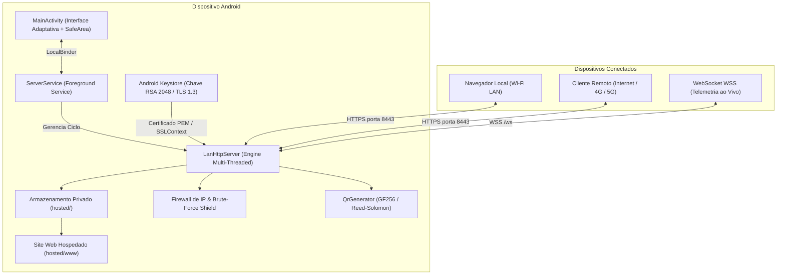

# AndServer 🚀

<p align="center">
  
</p>

<p align="center">
  
  
  
  
</p>

Aplicativo Android nativo, escrito em **Kotlin puro** (zero dependências externas), que transforma qualquer smartphone ou tablet em um **servidor HTTPS moderno, gerenciador de arquivos em nuvem pessoal e hospedagem de sites**, acessível tanto na **Rede Local (LAN)** quanto em **Toda a Internet (WAN)**.

---

## 📑 Índice

1. [Visão Geral e Filosofia do Projeto](#-visão-geral-e-filosofia-do-projeto)
2. [Demonstração Visual da Interface](#-demonstração-visual-da-interface)
3. [Arquitetura do Sistema](#-arquitetura-do-sistema)
4. [Alcance de Rede: Local (LAN) vs. Internet (WAN)](#-alcance-de-rede-local-lan-vs-internet-wan)
5. [Hospedagem de Sites Web no Dispositivo (`/hosted/www`)](#-hospedagem-de-sites-web-no-dispositivo-hostedwww)
6. [As 5 Novas Funcionalidades Integradas](#-as-5-novas-funcionalidades-integradas)
7. [Segurança, Criptografia e Firewall](#-segurança-criptografia-e-firewall)
8. [Catálogo Completo da API REST & WebSocket](#-catálogo-completo-da-api-rest--websocket)
9. [Interface de Usuário Adaptativa com SafeArea](#-interface-de-usuário-adaptativa-com-safearea)
10. [Automação e CI/CD (GitHub Actions)](#-automação-e-cicd-github-actions)
11. [Instalação e Compilação](#-instalação-e-compilação)

---

## 💡 Visão Geral e Filosofia do Projeto

- **Zero Dependências Externas**: Todo o ecossistema (servidor HTTP/HTTPS, RFC 6455 WebSocket, gerador de QR Code com correção Reed-Solomon, compactador ZIP em streaming e interface adaptativa) é implementado exclusivamente com a biblioteca padrão do Kotlin e APIs nativas do Android SDK.
- **Portabilidade Total**: Compatível a partir do Android 8.0 (API 26) até o Android 15+ (API 35).
- **Consumo Mínimo de Bateria e Memória**: Utiliza sockets diretos de baixo nível (`SSLServerSocket`), buffers otimizados de 32 KB e pool de threads elástico (`ThreadPoolExecutor`) limitado à capacidade configurada.

---

## 📸 Demonstração Visual da Interface

### 📱 1. Aplicativo no Celular vs. 📟 Layout Adaptativo no Tablet

<p align="center">
  
  &nbsp;&nbsp;&nbsp;&nbsp;
  
</p>

*À esquerda: visual vertical otimizado para celulares com SafeArea ativo e cópia de IP em um toque. À direita: layout ergonômico dividido em duas colunas para tablets.*

---

### 🌐 2. Painel Web Responsivo (Navegador Desktop e Mobile)

<p align="center">
  
</p>

*Painel do servidor acessível por qualquer navegador com arrastar e soltar (Drag & Drop), streaming de arquivos e telemetria WebSocket em tempo real.*

---

### 📲 3. Conexão Instantânea via QR Code

<p align="center">
  
</p>

*Aponte a câmera de outro smartphone, tablet ou computador para acessar o servidor instantaneamente sem precisar digitar o endereço IP.*

---

## 🏛️ Arquitetura do Sistema



### Componentes Principais:
1. **[MainActivity.kt](file:///c:/Users/aldo/Documents/AndServer/app/src/main/java/com/andserver/MainActivity.kt)**: Controla a interface gráfica nativa com cálculo dinâmico de `WindowInsets` (SafeArea para entalhes de tela e barras gestuais). Alterna automaticamente entre modo compacto para smartphones e 2 colunas para tablets (`smallestScreenWidthDp >= 600`).
2. **[ServerService.kt](file:///c:/Users/aldo/Documents/AndServer/app/src/main/java/com/andserver/ServerService.kt)**: Serviço em primeiro plano (`Foreground Service`) com notificação persistente que mantém a CPU e o rádio Wi-Fi ativos mesmo quando o aplicativo é minimizado ou a tela desligada.
3. **[TlsIdentity.kt](file:///c:/Users/aldo/Documents/AndServer/app/src/main/java/com/andserver/TlsIdentity.kt)**: Gera chave assimétrica RSA de 2048 bits com certificado autoassinado X.509 armazenado em hardware seguro do Android Keystore, viabilizando TLS 1.2 e TLS 1.3.
4. **[QrGenerator.kt](file:///c:/Users/aldo/Documents/AndServer/app/src/main/java/com/andserver/QrGenerator.kt)**: Algoritmo autônomo de codificação QR Code ISO/IEC 18004 com modos de dados em bytes, aritmética de corpos de Galois $\text{GF}(2^8)$ e correção de erro Reed-Solomon.

---

## 🌐 Alcance de Rede: Local (LAN) vs. Internet (WAN)

O aplicativo permite alternar instantaneamente entre dois modos de operação:

### 🏠 Modo 1: Apenas Rede Local (LAN)
- **Filtro de Endereçamento**: Verifica se o IP do cliente é privado conforme a RFC 1918 (`10.0.0.0/8`, `172.16.0.0/12`, `192.168.0.0/16`) ou loopback (`127.0.0.1`, `::1`).
- **Comportamento do Firewall**: Qualquer conexão originada de um IP público externo é rejeitada imediatamente com status `HTTP 403 Forbidden`:
  ```json
  {"error": "Acesso restrito a rede local. Altere para o modo 'Toda a Internet' para conexoes externas."}
  ```
- **Uso ideal**: Compartilhamento doméstico, reuniões presenciais e transferência rápida de arquivos em redes Wi-Fi confiáveis.

### 🌍 Modo 2: Toda a Internet (Público / WAN)
- **Acesso Global**: Conexões de qualquer lugar do mundo são aceitas.
- **Detecção de IP Público**: O servidor efetua uma requisição assíncrona leve em segundo plano para consultar o endereço de IP público do dispositivo (`publicIp`), exibindo-o tanto no aplicativo quanto no painel web.
- **Encaminhamento de Portas (NAT)**: Se o celular estiver conectado a um roteador Wi-Fi residencial com IP privado, basta criar uma regra de redirecionamento de portas (Port Forwarding da porta 8443) no roteador para o IP local do celular, tornando o servidor acessível pelo seu IP público em qualquer lugar.

---

## 🚀 Hospedagem de Sites Web no Dispositivo (`/hosted/www`)

O AndServer inclui suporte de primeira classe para transformar seu dispositivo em um servidor web estático e hospedeiro de **Single Page Applications (SPAs)**:

- **Pasta Raiz `/hosted/www`**: Ao ativar o perfil **"🌐 Site Web Hospedado"**, a raiz `https://<ip>:<porta>/` serve diretamente o arquivo `index.html` e seus recursos associados.
- **Site Template Pronto para Uso**: O aplicativo inicializa automaticamente um site moderno e responsivo com:
  - Layout elegante Dark Mode com gradientes esmeralda e sky blue.
  - Grade de apresentação de recursos.
  - **Testador Interativo de APIs**: Botões que executam requisições assíncronas em tempo real via JavaScript para `/health` e `/api/status`, demonstrando integração frontend-backend no mesmo host.
- **Suporte a SPAs e Roteamento**: Roteador inteligente que fornece fallback automático para `index.html` em rotas virtuais (React Router, Vue Router, Angular).
- **Gerenciador de Site Integrado**: Na aba **Ajustes**, botões rápidos permitem **Restaurar Site Padrão** ou **Ativar Perfil Site** em um clique. Envie ou atualize seus próprios arquivos HTML/CSS/JS via painel web ou API REST.

---

## ✨ As 5 Novas Funcionalidades Integradas

### 📱 Feature 1: QR Code de Conexão Instantânea
- **Como funciona**: Ao tocar no botão **"📱 QR CODE"** no app nativo ou no painel web, o servidor codifica a URL completa de acesso (`https://IP:PORTA`) em uma matriz bidimensional de módulos pretos e brancos.
- **Conexão sem digitação**: Permite que qualquer pessoa conecte seu smartphone ou notebook simplesmente apontando a câmera do aparelho, eliminando erros de digitação de IPs longos.

### 🛡️ Feature 2: Escudo Anti-Força Bruta (Brute-Force Shield)
- **Tabela de Reputação em Memória**: `ConcurrentHashMap<String, IpBlock>` monitora falhas de autenticação HTTP Basic.
- **Auto-Ban de 5 minutos**: Se um cliente errar a senha 5 vezes consecutivas:
  - O IP é suspenso por 300 segundos.
  - Qualquer requisição subsequente recebe resposta imediata `HTTP 429 Too Many Requests` com cabeçalho `Retry-After: 300`.
  - Sucesso de login limpa o histórico de falhas do IP.

### 📦 Feature 3: Download em Lote Compactado (.ZIP)
- **Rota `GET /api/zip?path={pasta}`**:
  - Compacta diretórios e arquivos em tempo real utilizando `java.util.zip.ZipOutputStream`.
  - Transmite os dados como fluxo contínuo (`streaming`), sem necessidade de criar arquivos compactados intermediários no disco, economizando memória flash do aparelho.
  - No painel web, o botão **"📦 Baixar Tudo (.ZIP)"** baixa todo o acervo do servidor em um único arquivo `.zip`.

### 🔗 Feature 4: Links de Compartilhamento Temporário com Expiração
- **Rota `POST /api/share`**:
  - Permite criar um link exclusivo de download avulso para um arquivo específico.
  - **Prazos selecionáveis**: 1 hora, 12 horas, 24 horas, 3 dias ou 7 dias.
  - **Rota `GET /share/{token}`**: Permite que quem receber o link baixe o arquivo correspondente **sem precisar saber a senha de administrador do servidor**. Ao expirar, a rota retorna `HTTP 410 Gone`.

### 🎬 Feature 5: Streaming e Player de Mídia In-Browser
- O painel web inclui players nativos HTML5 e visualizador lightbox:
  - **Imagens** (`.png`, `.jpg`, `.jpeg`, `.webp`, `.svg`, `.gif`): Abre em modal em tela cheia com alta resolução.
  - **Áudio** (`.mp3`, `.wav`, `.ogg`, `.flac`, `.aac`): Barra de áudio integrada com controles de play, pause e volume.
  - **Vídeo** (`.mp4`, `.webm`, `.mkv`): Reprodutor de vídeo HTML5 com aceleração por hardware e streaming com requisições HTTP `Range` (permitindo avançar e retroceder o vídeo).

---

## 🔒 Segurança, Criptografia e Firewall

1. **Protocolo TLS Obrigatório**: O servidor rejeita conexões HTTP puras em texto claro. Todas as conexões utilizam TLS 1.2 ou TLS 1.3 com cifras seguras.
2. **Prevenção contra Path Traversal**: Todas as requisições de arquivos passam pelo validador `resolvePath()`, que bloqueia sequências `../`, caracteres nulos `\0` e barras invertidas `\`.
3. **Limite de Payload**: Uploads são restritos ao limite de 100 MB por arquivo para evitar esgotamento de memória e espaço em disco.
4. **Isolamento de Armazenamento**: Os arquivos residem exclusivamente no diretório privado da aplicação (`context.filesDir/hosted/`).

---

## 🛠️ Catálogo Completo da API REST & WebSocket

| Método | Rota | Autenticação | Descrição |
| :--- | :--- | :--- | :--- |
| `GET` | `/` | Aberto / Básica | Carrega o **Site Web Hospedado** (no perfil `site`) ou o Painel Admin (no perfil `web`) |
| `GET` | `/{arquivo}` | Aberto / Básica | Recursos estáticos do site hospedado (`index.html`, `style.css`, `app.js`, imagens, etc.) |
| `GET` | `/health` | Aberto | Retorna `{"status":"ok"}` para monitoramento e health check |
| `GET` | `/api/status` | Básica (se ativa) | Métricas, uptime, conexões, tráfego de dados e IP público |
| `GET` | `/api/update` | Básica (se ativa) | Consulta a versão mais recente e notas de release do GitHub |
| `GET` | `/api/system` | Básica (se ativa) | Recursos de hardware (CPU, modelo, memória JVM) |
| `GET` | `/api/logs` | Básica (se ativa) | Últimos 500 registros de conexões em JSON |
| `GET` | `/api/logs.txt` | Básica (se ativa) | Histórico de log em texto puro |
| `GET` | `/api/certificate` | Aberto | Download do certificado público em formato `.pem` |
| `GET` | `/api/qrcode?text={url}`| Aberto | Gera e retorna imagem vetorial SVG do QR Code dinâmico |
| `GET` | `/api/ws-token` | Básica (se ativa) | Token seguro descartável para upgrade WebSocket |
| `WSS` | `/ws?token={token}` | Token | Conexão WebSocket segura RFC 6455 para telemetria em tempo real |
| `GET` | `/api/files` | Básica (se ativa) | Lista recursiva de pastas e arquivos hospedados |
| `GET` | `/api/zip?path={pasta}` | Básica (se ativa) | Compacta e transmite a pasta em formato `.zip` via streaming |
| `POST`| `/api/share` | Básica (se ativa) | Cria link temporário expirável para um arquivo |
| `GET` | `/share/{token}` | Token no Link | Download público do arquivo compartilhado via token |
| `PUT` | `/api/files/{caminho}` | Básica (se ativa) | Upload de arquivo (até 100 MB com gravação atômica) |
| `MKCOL`| `/api/files/{pasta}` | Básica (se ativa) | Criação de novo diretório |
| `DELETE`| `/api/files/{caminho}`| Básica (se ativa) | Remoção definitiva de arquivo ou pasta |
| `GET` | `/files/{caminho}` | Básica (se ativa) | Download direto com suporte a requisições parciais `Range` |
| `GET` | `/public/{caminho}`| Básica (se ativa) | Visualização inline de sites estáticos ou mídias |
| `GET` | `/api/config` | Básica (se ativa) | Consulta configurações atuais do servidor |
| `PUT` | `/api/config` | Básica (se ativa) | Atualiza configurações e reinicia o serviço |

---

## 📐 Interface de Usuário Adaptativa com SafeArea

O aplicativo conta com quatro experiências ergonômicas de interface:

1. **Celulares (Visual Vertical Compacto com SafeArea Ativo)**:
   - Suporte total a **SafeArea** nativo via `WindowInsets` e `displayCutout` (entalhe de câmera, furos e cantos curvos de tela).
   - Inset seguro para barras de navegação gestual do Android e barra de status.
   - Cartões empilhados verticalmente para uso confortável com uma mão.
   - Ação rápida de toque para copiar os endereços IP (LAN e WAN).
   - Diálogo com QR Code de alta resolução.
2. **Tablets (Layout Dividido em Duas Colunas com Margens Seguras)**:
   - Identificação automática de telas a partir de 600dp.
   - Respeito integral às barras de sistema e entalhes laterais ou superiores.
   - **Coluna Esquerda**: Controles operacionais, estado online, endereços de rede e resumo de segurança.
   - **Coluna Direita**: Grade de 6 métricas em tempo real e terminal de logs com rolagem contínua.
3. **Site Web Hospedado (`/hosted/www`)**:
   - Template completo pré-instalado em HTML5, CSS3 moderno e JS interativo.
   - Servido diretamente na raiz `https://<ip>:<porta>/` com respostas instantâneas, caching ETag e suporte a SPAs.
4. **Navegador Web (Dashboard Desktop / Mobile Web)**:
   - Suporte a arrastar e soltar múltiplos arquivos (*Drag & Drop*).
   - Filtragem e pesquisa instantânea de arquivos.
   - Pré-visualização de fotos, músicas e vídeos sem download.

---

## 🤖 Automação e CI/CD (GitHub Actions)

O repositório possui uma pipeline completa configurada em [.github/workflows/build-and-release.yml](.github/workflows/build-and-release.yml) que:

1. Executa a compilação a cada `git push` nas branches `main` ou `master` e em tags `v*`.
2. Compila os binários com **JDK 17** e **Gradle 8.10.2** em ambiente Linux (`ubuntu-latest`).
3. Publica automaticamente os APKs na aba **Releases** do repositório:
   - **`AndServer-release.apk`**: APK assinado e pronto para instalar diretamente no celular ou tablet.
   - **`AndServer-debug.apk`**: APK com símbolos de depuração.

### Atualizador pelo GitHub Releases

Na aba **Atualizações**, o aplicativo consulta `releases/latest` do GitHub, localiza `AndServer-release.apk`, valida o pacote e o número da versão, baixa o arquivo por HTTPS e abre uma sessão do instalador nativo do Android. A instalação exige confirmação do usuário. Não há backend próprio. Como o app instala APKs, o Android pode pedir que o usuário permita instalações para AndServer nas configurações do sistema.

Para manter as atualizações instaláveis sobre versões anteriores, configure nos Secrets do repositório `ANDROID_KEYSTORE_BASE64`, `ANDROID_KEYSTORE_PASSWORD`, `ANDROID_KEY_ALIAS` e `ANDROID_KEY_PASSWORD`. A keystore deve ser a mesma usada nas versões já distribuídas. O workflow falha se esses Secrets estiverem ausentes; usar uma chave nova fará o Android rejeitar a atualização por incompatibilidade de assinatura. As releases antigas deste workflow usavam a chave de depuração temporária do runner; por isso, a primeira versão assinada com a keystore persistente precisa ser instalada manualmente. Depois disso, as atualizações podem ser instaladas pelo app. O pipeline define `versionCode` crescente pelo número da execução e atualiza `versionName` pela tag ou build.

---

## 💻 Instalação e Compilação

1. Clone o repositório ou abra a pasta no **Android Studio Ladybug (ou superior)**:
   ```bash
   git clone https://github.com/seu-usuario/AndServer.git
   ```
2. Certifique-se de ter o **Android SDK 35** instalado.
3. Conecte seu dispositivo Android com depuração USB ativada ou inicie um emulador.
4. Para compilar via linha de comando:
   ```bash
   # Compilar APK de Release assinado
   ./gradlew assembleRelease

   # Compilar APK de Debug
   ./gradlew assembleDebug
   ```
