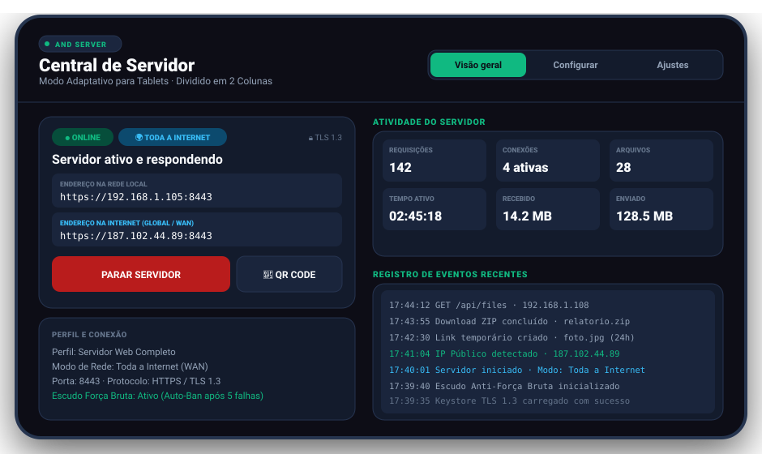
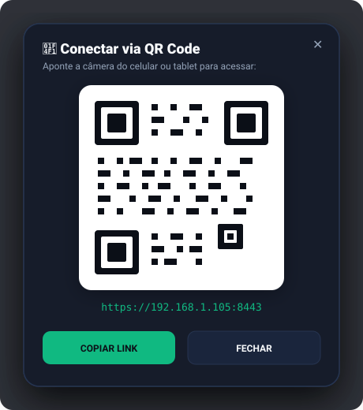

# AndServer 🚀

<p align="center">
  
  
  
  
</p>

Aplicativo Android nativo, escrito em **Kotlin puro** (zero dependências externas), que transforma qualquer smartphone ou tablet em um **servidor HTTPS moderno e gerenciador de arquivos em nuvem pessoal**, acessível tanto na **Rede Local (LAN)** quanto em **Toda a Internet (WAN)**.

---

## 📸 Demonstração Visual da Interface

### 📱 1. Aplicativo no Celular vs. 📟 Layout Adaptativo no Tablet

<p align="center">
  
  &nbsp;&nbsp;&nbsp;&nbsp;
  
</p>

*À esquerda: visual vertical otimizado para celulares com cópia de IP em um toque. À direita: layout ergonômico dividido em duas colunas para tablets.*

---

### 🌐 2. Painel Web Responsivo (Navegador Desktop e Mobile)

<p align="center">
  
</p>

*Painel do servidor acessível por qualquer navegador com arrastar e soltar (Drag & Drop), streaming de arquivos e telemetria WebSocket em tempo real.*

---

### 📲 3. Conexão Instantânea via QR Code

<p align="center">
  
</p>

*Aponte a câmera de outro smartphone, tablet ou computador para acessar o servidor instantaneamente sem precisar digitar o endereço IP.*

---

## 🌟 Principais Recursos

- **🌐 Alcance de Rede Configurável**:
  - **🏠 Rede Local (LAN)**: Atende exclusivamente a dispositivos na mesma rede Wi-Fi / IPs privados (RFC 1918). Conexões externas da Internet são bloqueadas pelo firewall nativo (`HTTP 403`).
  - **🌍 Toda a Internet (Público / WAN)**: Conexões liberadas de qualquer lugar do mundo. Detecta e exibe seu **IP Público** em tempo real e ativa o escudo de proteção.
- **🛡️ Escudo Anti-Força Bruta (Brute-Force Shield)**: Bloqueia automaticamente por 5 minutos qualquer IP que falhar 5 tentativas incorretas de senha (`HTTP 429`).
- **📱 QR Code Autônomo**: Gerador de QR Code em Kotlin puro (aritmética de Galois e Reed-Solomon) integrado no app e no painel web.
- **📦 Download em Lote (.ZIP)**: Compactação e download de pastas completas e múltiplos arquivos via streaming contínuo (`/api/zip`).
- **🔗 Compartilhamento com Links Temporários**: Crie links de download avulsos (`/share/{token}`) com prazos pré-determinados (1h até 7 dias) sem revelar sua senha.
- **🎬 Streaming e Player de Mídia In-Browser**: Visualizador de fotos em alta resolução (lightbox) e reprodutores HTML5 de áudio e vídeo sem necessidade de baixar.
- **🔒 Criptografia Forte com Android Keystore**: Chave privada RSA mantida em hardware seguro com suporte a **TLS 1.2 e TLS 1.3**.
- **⚡ Telemetria ao Vivo via WebSocket**: Monitoramento em tempo real de requisições, clientes conectados, CPU e memória.

---

## 📖 Documentação Técnica Completa

Para especificações arquiteturais detalhadas, diagramas de fluxo, catálogo de todas as rotas da API REST e guia de criptografia, consulte o documento:

👉 **[docs/DOCUMENTACAO.md](docs/DOCUMENTACAO.md)**

---

## 🛠️ Catálogo Resumido da API

```text
GET    /                               # Painel Web do Servidor
GET    /health                         # Verificação de disponibilidade (Health Check)
GET    /api/status                     # Métricas, IP público, conexões e tráfego
GET    /api/system                     # Recursos do dispositivo (CPU, memória JVM)
GET    /api/logs                       # Histórico recente de conexões (JSON)
GET    /api/certificate                # Download do certificado TLS autoassinado (.pem)
GET    /api/qrcode?text={url}          # Geração dinâmica de QR Code SVG
GET    /api/files                      # Listagem recursiva de arquivos e diretórios
GET    /api/zip?path={pasta}           # Download de pasta completa compactada em ZIP
POST   /api/share                      # Gerar link temporário com expiração (1h a 7d)
GET    /share/{token}                  # Download do arquivo compartilhado via token público
PUT    /api/files/{caminho}            # Upload de arquivo (até 100 MB com gravação atômica)
MKCOL  /api/files/{pasta}              # Criação de novo diretório
DELETE /api/files/{caminho}            # Remoção definitiva de arquivo ou pasta
GET    /files/{caminho}                # Download direto com suporte a Range (retomável)
GET    /public/{caminho}               # Visualização inline de sites estáticos ou mídias
WSS    /ws                             # Conexão WebSocket segura RFC 6455
```

---

## 🤖 CI/CD Automatizado com GitHub Actions

O repositório possui uma pipeline completa configurada em [.github/workflows/build-and-release.yml](.github/workflows/build-and-release.yml) que:

1. Executa a compilação a cada `git push` nas branches `main` ou `master` e em tags `v*`.
2. Compila os binários com **JDK 17** e **Gradle 8.10.2**.
3. Publica automaticamente os APKs na aba **Releases** do repositório:
   - **`AndServer-release.apk`**: APK assinado e pronto para instalar diretamente no celular ou tablet.
   - **`AndServer-debug.apk`**: APK com símbolos de depuração.

---

## 💻 Compilação Local

Abra o diretório no **Android Studio** com o **Android SDK 35** instalado:

```bash
# Compilar APK de Release assinado
./gradlew assembleRelease

# Compilar APK de Debug
./gradlew assembleDebug
```
