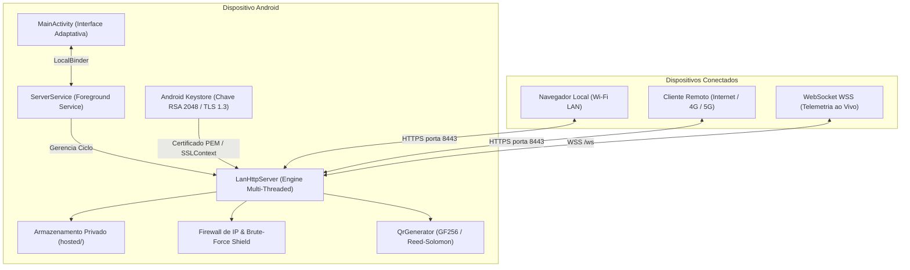

# Documentação Completa do AndServer

O **AndServer** é uma aplicação nativa para Android desenvolvida em **Kotlin puro**, sem bibliotecas externas adicionais, projetada para transformar qualquer smartphone ou tablet Android em um **servidor HTTPS robusto, seguro e de alta performance**, com gerenciamento de arquivos em tempo real e controle de acesso para **Rede Local (LAN)** ou **Toda a Internet (WAN)**.

---

## 📑 Índice

1. [Visão Geral e Filosofia do Projeto](#1-visão-geral-e-filosofia-do-projeto)
2. [Arquitetura do Sistema](#2-arquitetura-do-sistema)
3. [Alcance de Rede: Local (LAN) vs. Internet (WAN)](#3-alcance-de-rede-local-lan-vs-internet-wan)
4. [As 5 Novas Funcionalidades Integradas](#4-as-5-novas-funcionalidades-integradas)
5. [Segurança, Criptografia e Firewall](#5-segurança-criptografia-e-firewall)
6. [Catálogo Completo da API REST & WebSocket](#6-catálogo-completo-da-api-rest--websocket)
7. [Interface de Usuário Adaptativa (Celular, Tablet e Web)](#7-interface-de-usuário-adaptativa-celular-tablet-e-web)
8. [Automação e CI/CD (GitHub Actions)](#8-automação-e-cicd-github-actions)
9. [Instalação e Compilação](#9-instalação-e-compilação)

---

## 1. Visão Geral e Filosofia do Projeto

- **Zero Dependências Externas**: Todo o ecossistema (servidor HTTP/HTTPS, RFC 6455 WebSocket, gerador de QR Code com correção Reed-Solomon, compactador ZIP e interface adaptativa) é implementado exclusivamente com a biblioteca padrão do Kotlin e APIs oficiais do Android SDK.
- **Portabilidade Total**: Executa a partir do Android 8.0 (API 26) até o Android 15+ (API 35).
- **Consumo Mínimo de Bateria e Memória**: Utiliza sockets diretos de baixo nível (`SSLServerSocket`), buffers otimizados de 32 KB e pool de threads elástico (`ThreadPoolExecutor`) limitado à capacidade configurada.

---

## 2. Arquitetura do Sistema



### Componentes Principais:
1. **[MainActivity.kt](file:///c:/Users/aldo/Documents/AndServer/app/src/main/java/com/andserver/MainActivity.kt)**: Controla a interface gráfica nativa em tempo real. Identifica automaticamente a largura da tela (`smallestScreenWidthDp >= 600`) para alternar entre visual vertical para smartphones e layout em duas colunas para tablets.
2. **[ServerService.kt](file:///c:/Users/aldo/Documents/AndServer/app/src/main/java/com/andserver/ServerService.kt)**: Serviço em primeiro plano (`Foreground Service`) com notificação permanente que mantém a CPU e o rádio Wi-Fi ativos mesmo quando o aplicativo é minimizado.
3. **[TlsIdentity.kt](file:///c:/Users/aldo/Documents/AndServer/app/src/main/java/com/andserver/TlsIdentity.kt)**: Responsável por gerar um par de chaves assimétricas RSA de 2048 bits com certificado autoassinado X.509 armazenado no hardware de segurança do Android Keystore.
4. **[QrGenerator.kt](file:///c:/Users/aldo/Documents/AndServer/app/src/main/java/com/andserver/QrGenerator.kt)**: Algoritmo autônomo de codificação QR Code ISO/IEC 18004 com modos de dados em bytes, aritmética de corpos de Galois $\text{GF}(2^8)$, polinômios geradores e máscara $0$ (`(row + col) % 2 == 0`).

---

## 3. Alcance de Rede: Local (LAN) vs. Internet (WAN)

O aplicativo permite alternar instantaneamente entre dois modos de operação:

### 🏠 Modo 1: Apenas Rede Local (LAN)
- **Filtro de Endereçamento**: Verifica se o IP do cliente é privado conforme a RFC 1918 (`10.0.0.0/8`, `172.16.0.0/12`, `192.168.0.0/16`) ou loopback (`127.0.0.1`, `::1`).
- **Comportamento do Firewall**: Qualquer conexão originada de um IP público externo é rejeitada imediatamente com status `HTTP 403 Forbidden`:
  ```json
  {"error": "Acesso restrito a rede local. Altere para o modo 'Toda a Internet' para conexoes externas."}
  ```
- **Uso ideal**: Compartilhamento doméstico, reuniões presenciais e transferência rápida de arquivos em redes Wi-Fi confiáveis.

### 🌍 Modo 2: Toda a Internet (Público / WAN)
- **Acesso Global**: Conexões de qualquer lugar do mundo são aceitas.
- **Detecção de IP Público**: O servidor efetua uma requisição assíncrona leve em segundo plano para consultar o endereço de IP público do dispositivo (`publicIp`), exibindo-o tanto no aplicativo quanto no painel web.
- **Encaminhamento de Portas (NAT)**: Se o celular estiver conectado a um roteador Wi-Fi residencial com IP privado, basta criar uma regra de redirecionamento de portas (Port Forwarding da porta 8443) no roteador para o IP local do celular, tornando o servidor acessível pelo seu IP público em qualquer lugar.

---

## 4. As 5 Novas Funcionalidades Integradas

### 📱 Feature 1: QR Code de Conexão Instantânea
- **Como funciona**: Ao tocar no botão **"📱 QR CODE"** no app nativo ou no painel web, o servidor codifica a URL completa de acesso (`https://IP:PORTA`) em uma matriz bidimensional de módulos pretos e brancos.
- **Conexão sem digitação**: Permite que qualquer pessoa conecte seu smartphone ou notebook simplesmente apontando a câmera do aparelho, eliminando erros de digitação de IPs longos.

### 🛡️ Feature 2: Escudo Anti-Força Bruta (Brute-Force Shield)
- **Tabela de Reputação em Memória**: `ConcurrentHashMap<String, IpBlock>` monitora falhas de autenticação HTTP Basic.
- **Auto-Ban de 5 minutos**: Se um cliente errar a senha 5 vezes consecutivas:
  - O IP é suspenso por 300 segundos.
  - Qualquer requisição subsequente recebe resposta imediata `HTTP 429 Too Many Requests` com cabeçalho `Retry-After: 300`.
  - Sucesso de login limpa o histórico de falhas do IP.

### 📦 Feature 3: Download em Lote Compactado (.ZIP)
- **Rota `GET /api/zip?path={pasta}`**:
  - Compacta diretórios e arquivos em tempo real utilizando `java.util.zip.ZipOutputStream`.
  - Transmite os dados como fluxo contínuo (`streaming`), sem necessidade de criar arquivos compactados intermediários no disco, economizando memória flash do aparelho.
  - No painel web, o botão **"📦 Baixar Tudo (.ZIP)"** baixa todo o acervo do servidor em um único arquivo `.zip`.

### 🔗 Feature 4: Links de Compartilhamento Temporário com Expiração
- **Rota `POST /api/share`**:
  - Permite criar um link exclusivo de download avulso para um arquivo específico.
  - **Prazos selecionáveis**: 1 hora, 12 horas, 24 horas, 3 dias ou 7 dias.
  - **Rota `GET /share/{token}`**: Permite que quem receber o link baixe o arquivo correspondente **sem precisar saber a senha de administrador do servidor**. Ao expirar, a rota retorna `HTTP 410 Gone`.

### 🎬 Feature 5: Streaming e Player de Mídia In-Browser
- O painel web inclui players nativos HTML5 e visualizador lightbox:
  - **Imagens** (`.png`, `.jpg`, `.jpeg`, `.webp`, `.svg`, `.gif`): Abre em modal em tela cheia com alta resolução.
  - **Áudio** (`.mp3`, `.wav`, `.ogg`, `.flac`, `.aac`): Barra de áudio integrada com controles de play, pause e volume.
  - **Vídeo** (`.mp4`, `.webm`, `.mkv`): Reprodutor de vídeo HTML5 com suporte a aceleração por hardware e streaming com requisições HTTP `Range` (permitindo avançar e retroceder o vídeo).

---

## 5. Segurança, Criptografia e Firewall

1. **Protocolo TLS Obrigatório**: O servidor rejeita conexões HTTP puras em texto claro. Todas as conexões utilizam TLS 1.2 ou TLS 1.3 com cifras seguras.
2. **Prevenção contra Path Traversal**: Todas as requisições de arquivos passam pelo validador `resolvePath()`, que bloqueia sequências `../`, caracteres nulos `\0` e barras invertidas `\`.
3. **Limite de Payload**: Uploads são restritos ao limite de 100 MB por arquivo para evitar esgotamento de memória e espaço em disco.
4. **Isolamento de Armazenamento**: Os arquivos residem exclusivamente no diretório privado da aplicação (`context.filesDir/hosted/`).

---

## 6. Catálogo Completo da API REST & WebSocket

| Método | Rota | Autenticação | Descrição |
| :--- | :--- | :--- | :--- |
| `GET` | `/` | Básica (se ativa) | Painel Web responsivo do servidor |
| `GET` | `/health` | Aberto | Retorna `{"status":"ok"}` para monitoramento |
| `GET` | `/api/status` | Básica (se ativa) | Métricas, uptime, conexões e IP público |
| `GET` | `/api/system` | Básica (se ativa) | Recursos de hardware (CPU, modelo, memória JVM) |
| `GET` | `/api/logs` | Básica (se ativa) | Últimos 500 registros de conexões em JSON |
| `GET` | `/api/logs.txt` | Básica (se ativa) | Histórico de log em texto puro |
| `GET` | `/api/certificate` | Aberto | Download do certificado público em formato `.pem` |
| `GET` | `/api/qrcode?text={url}`| Aberto | Gera e retorna imagem vetorial SVG do QR Code |
| `GET` | `/api/ws-token` | Básica (se ativa) | Token seguro descartável para upgrade WebSocket |
| `WSS` | `/ws?token={token}` | Token | Conexão WebSocket para telemetria em tempo real |
| `GET` | `/api/files` | Básica (se ativa) | Lista recursiva de pastas e arquivos hospedados |
| `GET` | `/api/zip?path={pasta}` | Básica (se ativa) | Compacta e transmite a pasta em formato `.zip` |
| `POST`| `/api/share` | Básica (se ativa) | Cria link temporário expirável para um arquivo |
| `GET` | `/share/{token}` | Token no Link | Download público do arquivo compartilhado |
| `PUT` | `/api/files/{caminho}` | Básica (se ativa) | Upload de arquivo com escrita atômica |
| `MKCOL`| `/api/files/{pasta}` | Básica (se ativa) | Criação de novo diretório |
| `DELETE`| `/api/files/{caminho}`| Básica (se ativa) | Remoção definitiva de arquivo ou pasta |
| `GET` | `/files/{caminho}` | Básica (se ativa) | Download com suporte a requisições `Range` |
| `GET` | `/public/{caminho}`| Básica (se ativa) | Exibição inline de sites estáticos ou mídias |
| `GET` | `/api/config` | Básica (se ativa) | Consulta configurações atuais do servidor |
| `PUT` | `/api/config` | Básica (se ativa) | Atualiza configurações e reinicia o serviço |

---

## 7. Interface de Usuário Adaptativa (Celular, Tablet e Web)

O aplicativo conta com três experiências ergonômicas de interface:

1. **Celulares (Visual Vertical Compacto)**:
   - Cartões empilhados verticalmente para uso confortável com uma mão.
   - Ação rápida de toque para copiar os endereços IP (LAN e WAN).
   - Diálogo com QR Code de alta resolução.
2. **Tablets (Layout Dividido em Duas Colunas)**:
   - Identificação automática de telas a partir de 600dp.
   - **Coluna Esquerda**: Controles operacionais, estado online, endereços de rede e resumo de segurança.
   - **Coluna Direita**: Grade de 6 métricas em tempo real e terminal de logs com rolagem contínua.
3. **Navegador Web (Dashboard Desktop / Mobile Web)**:
   - Suporte a arrastar e soltar múltiplos arquivos (*Drag & Drop*).
   - Filtragem e pesquisa instantânea de arquivos.
   - Pré-visualização de fotos, músicas e vídeos sem download.

---

## 8. Automação e CI/CD (GitHub Actions)

O repositório inclui a pipeline automatizada configurada em [.github/workflows/build-and-release.yml](file:///c:/Users/aldo/Documents/AndServer/.github/workflows/build-and-release.yml).

- **Gatilho**: Disparado a cada commit enviado para as branches `main` ou `master` e em novas tags `v*`.
- **Compilação**: Utiliza JDK 17 e Gradle 8.10.2 em ambiente Linux (`ubuntu-latest`).
- **Geração de Artefatos**: Compila automaticamente:
  - `AndServer-release.apk`: Binário assinado pronto para distribuição pública.
  - `AndServer-debug.apk`: Binário para testes e depuração.
- **Publicação**: Cria automaticamente uma nova versão na seção **Releases** do repositório GitHub com os dois APKs anexados.

---

## 9. Instalação e Compilação

1. Clone o repositório ou abra a pasta no **Android Studio Ladybug (ou superior)**.
2. Certifique-se de ter o **Android SDK 35** instalado.
3. Conecte seu dispositivo Android com depuração USB ativada ou inicie um emulador.
4. Execute `./gradlew assembleDebug` ou clique no botão **Run** no Android Studio.
